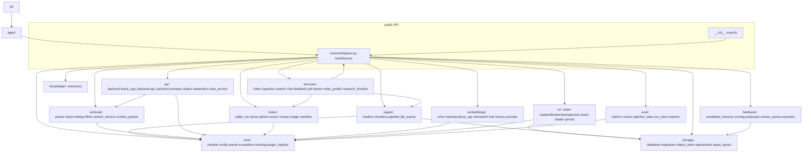

# Dependency Graph — Current State

Snapshot: 2026-09-21 · `libs/geomemory` v0.1.0 alpha
Normative source of truth: [`../../openspec/specs/`](../../openspec/specs/)
Comprehensive summary: [`../library-capabilities.md`](../library-capabilities.md)

## 1. Runtime dependencies (base install)

`pyproject.toml [project.dependencies]`: **pydantic≥2, numpy≥1.24, click≥8, PyYAML≥6, onnxruntime≥1.18, tokenizers≥0.15, huggingface-hub≥0.23, sqlite-vec≥0.1.6**

Everything heavy is opt-in:

| Extra | Packages | Used by |
|---|---|---|
| `docs` | pymupdf, python-docx | PDF/document parsing |
| `rs` | rasterio, shapely, geopandas, Pillow | `rs/raster/*`, `rs/vector/reader.py`, previews |
| `vector` | qdrant-client | `index/qdrant_backend.py` |
| `lancedb` | pylancedb | `index/lance_backend.py` |
| `vision` | torch, Pillow, olmoearth-pretrain-minimal | `embeddings/olmoearth_vision.py` |
| `llamacpp` | llama-cpp-python | legacy GGUF embedders and LLM backend |
| `opendataloader` | opendataloader-pdf | high-quality PDF parsing |
| `ui` | streamlit | `apps/*` |
| `dev` | pytest, pytest-cov, mypy, ruff, types-PyYAML | tooling |

Heavy imports are function-local where practical so the base import stays light and dependency-free.

## 2. Internal module graph

Key structural facts:

- `core/workspace.py` is the highest fan-out module; it delegates to all domain packages.
- Canonical search orchestration lives in `retrieval/search_service.py` with `rrf_fuse` and `apply_hit_filters`.
- Candidate memories are searched through `feedback/candidate_memory.py` and merged in the facade.
- Entity profiles and research timelines live in `services/` and consume `feedback/candidate_memory.py` and `storage/repositories/`.
- Tests exercise `geomemory` directly from `tests/unit` and `tests/integration`.

## 3. Toolchain

Python ≥3.10 · setuptools build · ruff (E/F/W/I/N/UP/B/SIM, line-length 100) · mypy `--strict` (src only) · pytest `--strict-markers` with markers `unit/integration/golden/e2e/spike` · coverage fail-under 80.